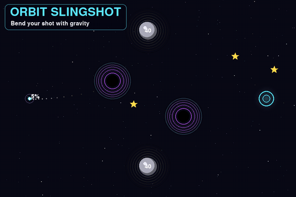

# Orbit Slingshot



**A gravity puzzle game made in one week for a game jam (theme: *Out of this world*).**

Pull back, release, and launch your probe. Every planet pulls it with gravity, so the straight
line is never the answer: curve your shot around worlds, slip between black holes, and land in
the target. Then take on giant alien bosses.

## Features

- **20 levels** that build up step by step: moving moons, binary stars, black holes, and tight
  gaps between giant planets
- **5 boss fights**: hit the alien's eye to damage it, and when a claw starts glowing you have
  a few seconds to hit it for bonus damage before it attacks
- **3 stars per level** to collect along tricky paths
- **Gravity rings** around every planet show how strong its pull is
- Level select: jump straight to any level or boss

## How to play

| Control | Action |
|---|---|
| Click + drag, then release | Pull back and launch the probe |
| R | Reset your shot |
| Enter / Space / Click | Continue |
| Esc | Back (level → level select → title) |

Reach the target to win. On boss levels you have a limited number of probes, so make every
shot count.

## Running the game

You need [Python 3](https://www.python.org/downloads/) and pygame:

```bash
pip install pygame
```

Then, from this folder:

```bash
python orbit-slingshot/main.py
```

## Credits

- **Programming and game design:** [your name]
- **Art:** [designer's name]

Built with Python and pygame.

## For developers

- `orbit-slingshot/levels.py`: every level and boss as simple data (the format is explained
  at the top of the file)
- `orbit-slingshot/tools/solve_levels.py`: tries thousands of shots per level to check every
  level can be beaten and every star collected
